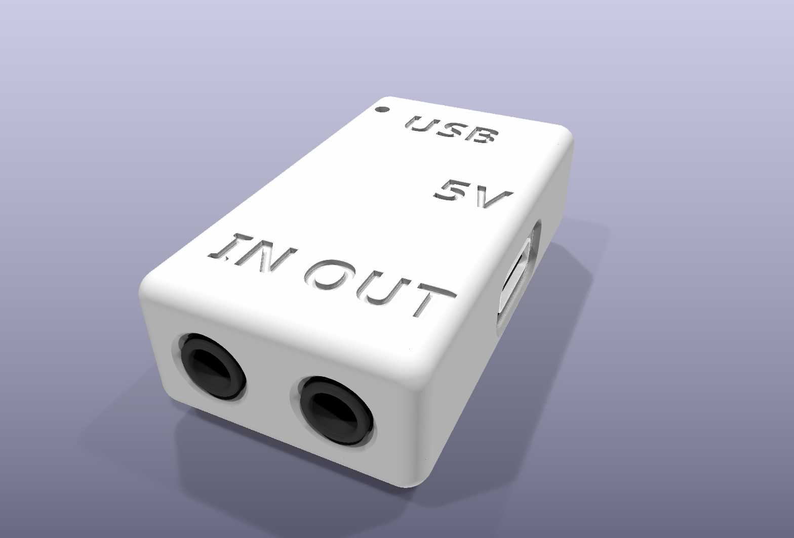
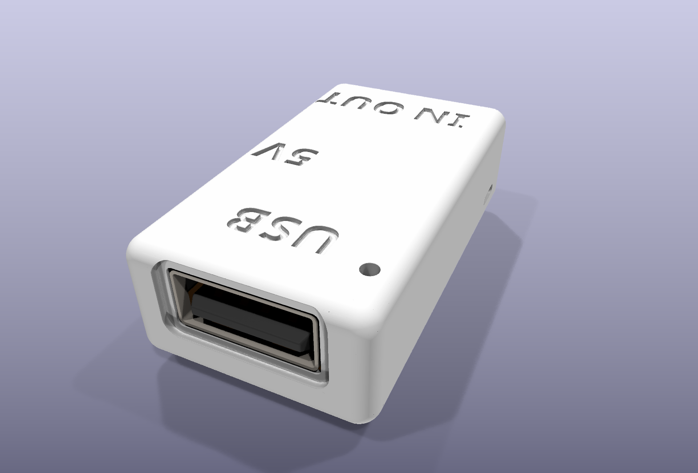
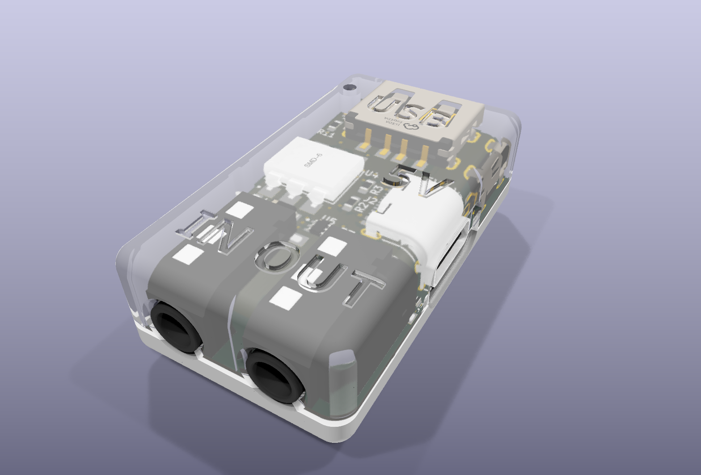

# FM-1 MIDI dongle v6: printable case

Two halves that snap together around the board. No screws, no glue. The case is generated by code
(`gen_case.py`, FreeCAD's OpenCascade kernel), so a board change means re-running the script, not re-drawing.

| | |
|---|---|
| Size | 22.8 × 41.0 × 12.2 mm, flat top and flat bottom (lies flat on a desk either way up) |
| Edges | every outer edge rounded 2.0 mm |
| Walls | 1.2 mm sides and USB end, 1.3 mm top / bottom, 1.7 mm at the jack end |
| Air | 0.3 mm over the tallest part on each face (USB-A on top, SY6280 underneath) |
| Halves | split at the board's top face; the bottom half carries the board, the top half clamps its edge |
| Fit | checked against every 3D part of the board: 0 collisions (`check_fit.py`) |





## Shape
- A rounded slab. The v6 board puts every tall part on the top face and only low parts (≤ 1.3 mm) underneath,
  so neither face needs a bump.
- Ports:
  - USB-A: in the end face, inside a 0.65 mm dish so a plug's overmold reaches the receptacle face.
  - USB-C (power): on the right side, in a dish whose floor is flush with the receptacle face, so the plug's
    overmold seats on it.
  - Jacks: noses flush with the far end face, through chamfered holes. IN on the left, OUT on the right (seen from
    the top).
- LED: a light pipe from the ceiling down to 0.3 mm over D2, open through the top beside the USB end.
- Engraved labels (0.45 mm deep): USB, 5V, IN, OUT.

## Print
- **Files:** `out/case_top_print.stl` (upside down, outer top face on the bed) and `out/case_bottom_print.stl` (outer
  bottom face on the bed). The lip, pins, light pipe and snaps all point up: no supports.
- **Material:** PETG or PLA. PETG flexes better for the snaps.
- **Settings:** 0.4 mm nozzle; 0.12 to 0.2 mm layers; 3 perimeters (= the 1.2 mm walls); 20 % infill; no supports.
- The engraved labels end up on the first layer of the top half. If they come out messy, print that half with
  "ironing" off and a slower first layer, or delete the labels in `gen_case.py`.
- **Resin printers:** use `out/case_top.stl` / `out/case_bottom.stl` in any orientation.

## Assemble
1. Drop the board into the bottom half, top face up: the two pins go through the board's side notches.
2. Press the top half on, USB end first (the USB-A slides into its opening), then close it toward the jacks.
   The four snaps click.
3. To open (e.g. to reach the GND / DIO / 3V3 programming pads under the board), put a fingernail or a small flat
   screwdriver in the notch on the left side near the jacks and lift.

## Tuning (top of `gen_case.py`)
| Parameter | Default | What it does |
|---|---|---|
| `CL` | 0.2 mm | board-to-wall gap. Raise to 0.25 if the board is tight. |
| `AIR` | 0.3 mm | air over the tallest part on each face (sets the slab height) |
| snap bump | 0.25 mm proud | in `main()`: `0.55 + 0.25 - 0.8`. Lower to 0.15 for a softer click, raise for a firmer one. |
| `W_SIDE` / `W_TOP` / `W_BOT` | 1.2 / 1.3 / 1.3 | walls |
| `R_OUT` | 2.0 mm | outer edge rounding |

## Regenerate
```sh
kicad-cli pcb export step --subst-models --force -o case/board.step fm1-midi-dongle.kicad_pcb   # after any board change
freecadcmd case/gen_case.py      # case/out/*.step, *.stl, *_print.stl (reads board.step for the part keep-outs)
freecadcmd case/check_fit.py     # 0 collisions expected
freecadcmd case/export_wrl.py && python3 case/render_kicad.py   # renders (KiCad raytracer)
```
Note: the PJ-320D jack's STEP model sits 4.1 mm off its footprint (the WRL that KiCad renders is right).
`gen_case.py` and `check_fit.py` move the jacks to their courtyards before using them.
