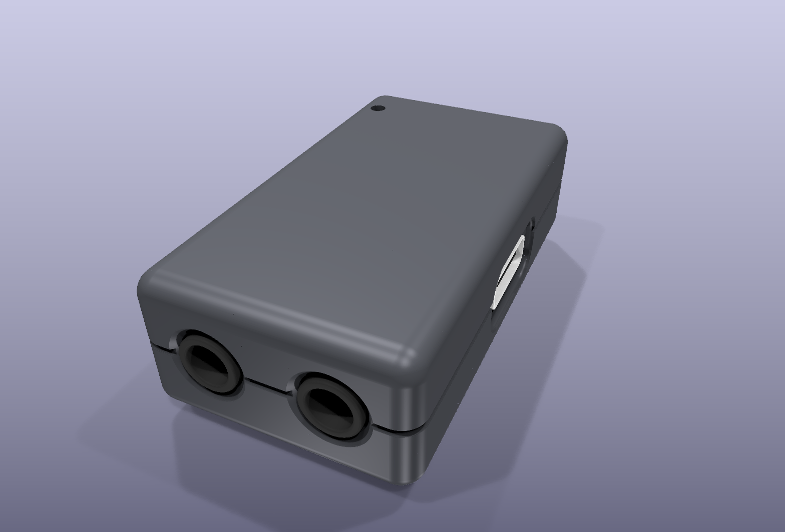
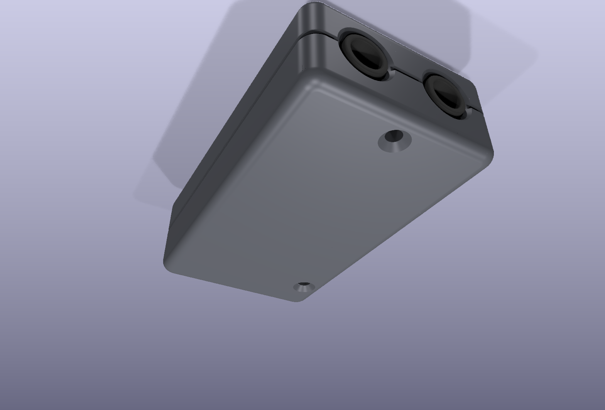
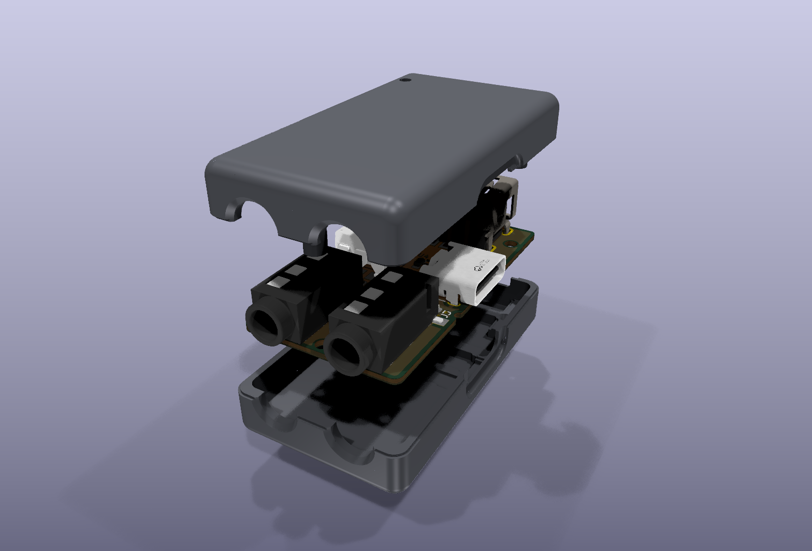
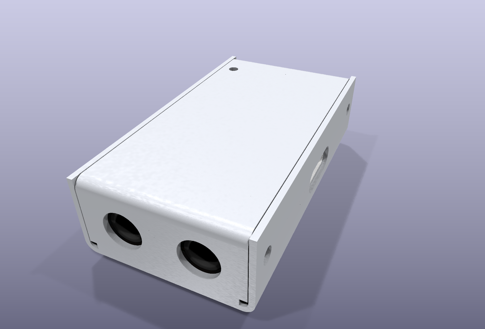
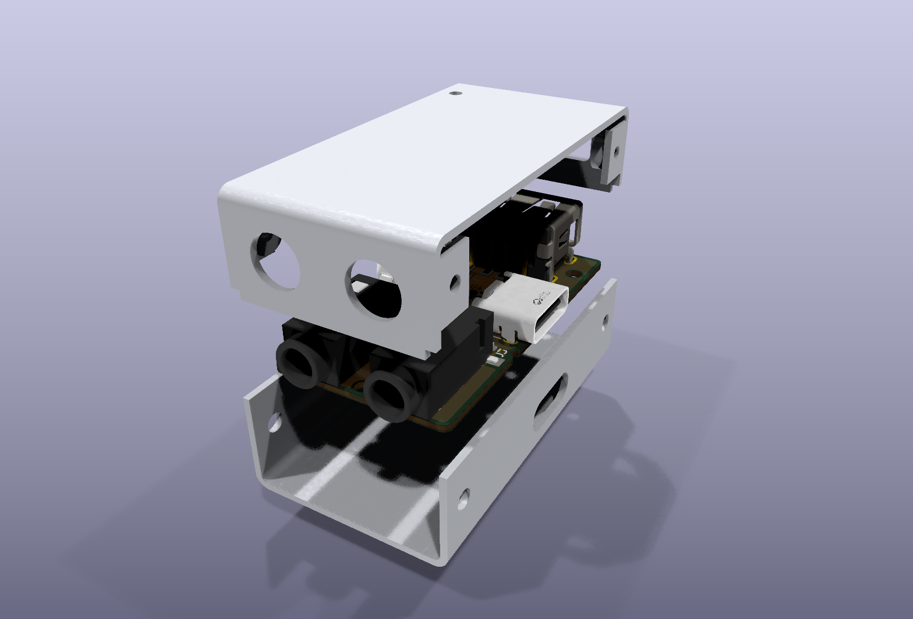

# FM-1 MIDI dongle v6.1: case (CNC aluminium or 3D printed)

One design, two materials. Two halves held by two M1.6 screws through the board's case holes H1 / H2. The case is
generated by code (`gen_case.py`, FreeCAD's OpenCascade kernel), so a board change means re-running the script.

| | |
|---|---|
| Size | 22.8 × 41.0 × 12.2 mm, flat top and bottom |
| Edges | top edges and corners R2.0, bottom edges R1.5 |
| Split | at the jacks' centre line (z 3.31 over the board bottom): every port is half in each half |
| Fastening | 2 × M1.6 × 6 countersunk (ISO 14581 / ISO 7046), from the bottom, flush |
| Walls | 1.15 mm sides, 1.3 mm top and bottom, 1.65 mm at the jack end; thinnest: 0.47 mm frame behind the USB-C dish, 0.5 mm behind the USB-A dish |
| Fit | `check_fit.py`: 0 collisions closed, 0 while assembling (board straight in, top straight down), screws clear of every part |
| Mass (6061) | ≈ 15.4 g (top 3.09 cm³ + bottom 2.62 cm³) |





## Why split at the jacks
The jack noses (5 mm) go 2 mm into the end wall, the USB-A front 0.5 mm into the other end wall, and the USB-C
0.5 mm into the side. A rigid lid can't slide onto all three at once. Split through their centre line, each half
holds half of every opening, open toward the seam: the board drops straight into the bottom half and the top
closes straight down. (The v6 snap case was split at the board face. It only closed if the jack-end wall bent by
about 2 mm, so it was replaced.)

## Aluminium (CNC milled)
- **Files:** `out/alu_top.step`, `out/alu_bottom.step` (+ `alu_assembly.step`). Marking artwork: `out/alu_marking.svg`.
- **Material / finish:** 6061-T6; bead blast + type II anodise (black or space grey). Anodising insulates, but the
  case is also kept off every copper pad on the board's bottom face (0.3 mm reliefs).
- **Machining:** 3-axis, two setups per half (seam side, outer side), no side operations. Every port is a trough cut
  from the seam face (ball or bull-nose end mill for the round parts). Pocket corners are drawn as the cutter
  leaves them: ⌀2 mm over the board, ⌀1 mm under it and in the dish floors. Deepest pocket 4.7 mm.
- **Threads:** top half, 2 × M1.6 × 0.35 in the pins at H1 (0, 34.4) and H2 (8.3, 3.0): drill ⌀1.25 × 4.0, thread 3.5.
  The screw engages about 2.2 mm.
- **Bottom half:** 2 × ⌀1.75 through, 90° countersink ⌀3.2.
- **Tolerances:** ±0.05 mm general; the seam faces flat within 0.05.
- **Labels:** laser marked (USB, 5V, IN, OUT), not engraved.
- **LED:** ⌀1.6 hole over D2; press in a ⌀1.5 × 7.1 mm clear PMMA rod (light pipe) with a drop of UV glue.
- **Seam:** a 0.3 × 0.3 mm reveal on each half, so a small mismatch reads as a shadow line.

## 3D printed
- **Files:** `out/print_top_print.stl` (outer top face on the bed), `out/print_bottom_print.stl` (outer bottom face on
  the bed). Every pocket, pin and port trough points up: no supports.
- Same geometry, with ⌀1.35 pilot holes in the pins: the M1.6 screw cuts its own thread. Labels engraved 0.45 mm.
- PETG or PLA, 0.4 mm nozzle, 0.12–0.2 mm layers, 3 perimeters, 20 % infill.

## Sheet metal (`gen_case_sheet.py`)
A different build, since bent parts can't hold a connector in a half hole (bending is ±0.3 mm at JLC).




| | |
|---|---|
| Size | 23.2 × 42.2 × 11.3 mm, ≈ 6.7 g |
| Material | 0.8 mm 5052-H32 aluminium, inside bend radius 0.8 |
| Base | bottom + both long sides; USB-C opening in the right side |
| Cover | top + both ends, dropped in between the base's sides; jack holes, USB-A opening, LED hole |
| Fastening | 4 tabs bent in from the cover's ends with M2 clinch nuts (PEM S-M2-0 class), 4 × M2 × 4 low-head screws through the sides |
| Board | on an M1.6 nut + washer spacer at H2, M1.6 × 6 screw from below, nut on top; the jack noses in their holes hold the other end (H1 has no room for a nut between the jack pads) |
| Fit | `CASE=sheet check_fit.py`: 0 collisions closed, 0 while assembling, H2 hardware clear |

Trade-offs against the milled case:
- every connector sits 0.9 mm behind the outside face (walls stand 0.1 mm clear of each connector face so the parts
  go together straight down). Most plugs still seat; a few with very short USB-C/USB-A overmolds may not.
- square ends, 1.6 mm outside bend radius on the long edges, four screw heads on the sides.

## Assemble (milled / printed)
1. Drop the board into the bottom half, top face up (jacks into their half holes).
2. Put the top half on straight down; its pins go onto the board's two holes.
3. Turn it over and fit the two M1.6 × 6 screws. They also locate the board (0.25 mm all round).

## Tuning (top of `gen_case.py`)
| Parameter | Default | What it does |
|---|---|---|
| `CL` | 0.25 mm | board edge to wall |
| `AIR` | 0.3 mm | air around every part |
| `TOOL_TOP` / `TOOL_BOT` | 1.0 / 0.5 mm | cutter radius the pockets are shaped for |
| `REVEAL` | 0.3 mm | seam shadow line |
| `R_V` / `R_TOP` / `R_BOT` | 2.0 / 2.0 / 1.5 | outer rounding |

## Regenerate
```sh
kicad-cli pcb export step --subst-models --force -o case/board.step fm1-midi-dongle.kicad_pcb   # after any board change
freecadcmd case/gen_case.py && freecadcmd case/check_fit.py            # aluminium (CASE=print for the printed one)
freecadcmd case/gen_case_sheet.py && CASE=sheet freecadcmd case/check_fit.py   # sheet metal
freecadcmd case/export_wrl.py && python3 case/render_kicad.py          # renders (KiCad raytracer), same CASE=
```
The PJ-320D jack's STEP model sits 4.1 mm off its footprint (the WRL that KiCad renders is right); `gen_case.py`
and `check_fit.py` move the jacks to their courtyards first.
